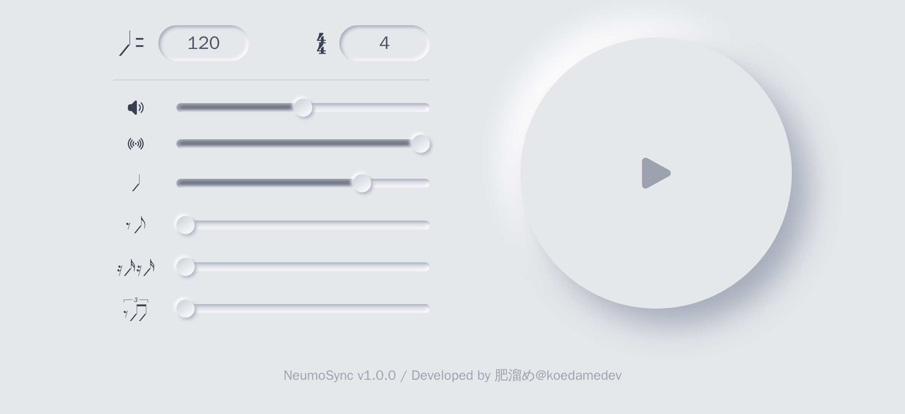

<div align="center">


# NeumoSync

**やわらかい Neumorphism の画面で、拍の種類ごとに音量を分けられるメトロノーム。**



[](https://github.com/koedame/neumosync/actions/workflows/audit.yml)
[](https://github.com/koedame/neumosync/actions/workflows/codeql.yml)


[English](README.md) | [日本語](README.ja.md)

[特徴](#特徴) · [ダウンロード](#ダウンロード) · [ソースからビルド](#ソースからビルド) · [使い方](#使い方)

</div>

NeumoSync は練習用のデスクトップのメトロノームです。テンポと 1 小節の拍数を決めたら、クリックの鳴らし方を調整できます。アクセント・4 分・8 分・16 分・3 連の音量をそれぞれ別のスライダーで決められるので、基本の拍の下で、ある拍の刻みだけを小さく鳴らして練習できます。

## 特徴

- **6 本の音量スライダー。** マスター・アクセント・4 分・8 分・16 分・3 連を個別に調整できます。
- **30〜300 BPM。** 入力欄にテンポを入力します。
- **1 小節 1〜300 拍。** アクセントは各小節の 1 拍目に鳴ります。
- **4 種類の音程。** アクセントは 880 Hz、4 分と 8 分は 440 Hz、16 分は 220 Hz、3 連は 300 Hz。どの刻みが鳴っているか耳で分かります。
- **安定したタイミング。** Web Worker の 25 ミリ秒のタイマーが、Web Audio の時計の 100 ミリ秒先までクリックを予約するので、画面の処理で拍がずれません。

## ダウンロード

配布用のビルド済みバイナリはまだ公開していません。ソースからビルドしてください（下記）。

## ソースからビルド

NeumoSync は [Tauri 2](https://v2.tauri.app/) のアプリで、画面は Vue 3 です。

### 事前準備

- [Bun](https://bun.sh/)
- [Rust](https://www.rust-lang.org/)
- お使いの OS の [Tauri v2 の前提条件](https://v2.tauri.app/start/prerequisites/)（Linux では webkit2gtk-4.1・libssl など）

### クイックスタート

```bash
git clone https://github.com/koedame/neumosync.git
cd neumosync
bun install
bun run tauri dev
```

インストール用のバンドルを作るときは `bun run tauri build` を実行します。成果物は `src-tauri/target/release/bundle/` に出ます。リポジトリの手動実行のビルド用ワークフローは、macOS（Apple シリコンと Intel）と Windows でこれを実行します。

## 使い方

| 操作する場所 | 動き |
|---|---|
| テンポの入力欄（4 分音符 =） | 1 分あたりの拍数。30〜300 |
| 拍数の入力欄（拍子の記号） | 1 小節の拍数。1〜300 |
| スピーカーのスライダー | 下のすべての音にかかるマスター音量 |
| 放送マークのスライダー | 各小節の 1 拍目のアクセント |
| 4 分音符のスライダー | 各拍の音量 |
| 8 分音符のスライダー | 拍の裏の 8 分音符の音量 |
| 16 分音符のスライダー | 16 分音符の刻みの音量 |
| 3 連符のスライダー | 3 連符の刻みの音量 |
| 丸いボタン | 開始と停止 |

起動直後の音量は、アクセントが 100%、4 分音符が 75%、8 分・16 分・3 連が 0 です。アクセント付きの単純なクリックから始まります。再生中はテンポと拍数の欄を変更できません。

## セキュリティ

脆弱性は [SECURITY.md](SECURITY.md) の手順で報告してください。

## ライセンス

[MIT](LICENSE)
