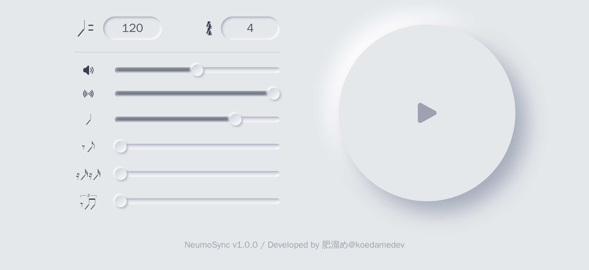

<div align="center">


# NeumoSync

**A metronome with a soft Neumorphism interface and separate volumes for every subdivision.**



[](https://github.com/koedame/neumosync/actions/workflows/audit.yml)
[](https://github.com/koedame/neumosync/actions/workflows/codeql.yml)


[English](README.md) | [日本語](README.ja.md)

[Highlights](#highlights) · [Download](#download) · [Build from source](#build-from-source) · [Usage](#usage)

</div>

NeumoSync is a desktop metronome for practice. Set a tempo and the number of beats per measure, then shape the click: the accent, quarter notes, eighth notes, sixteenth notes and triplets each have their own volume slider, so you can drill a subdivision quietly under the main beat.

## Highlights

- **Six volume sliders.** Master, accent, quarter, eighth, sixteenth and triplet each get their own level.
- **30 to 300 BPM.** Type the tempo into the field.
- **1 to 300 beats per measure.** The accent falls on the first beat of every measure.
- **Four pitches.** 880 Hz for the accent, 440 Hz for quarter and eighth notes, 220 Hz for sixteenths and 300 Hz for triplets, so you can hear which subdivision is playing.
- **Steady timing.** Clicks are scheduled on the Web Audio clock, 100 ms ahead, from a 25 ms timer in a Web Worker, so the interface never delays a beat.

## Download

No prebuilt binaries are published yet. Build from source (see below).

## Build from source

NeumoSync is a [Tauri 2](https://v2.tauri.app/) app with a Vue 3 front end.

### Prerequisites

- [Bun](https://bun.sh/)
- [Rust](https://www.rust-lang.org/)
- The [Tauri v2 prerequisites](https://v2.tauri.app/start/prerequisites/) for your OS (on Linux: webkit2gtk-4.1, libssl, etc.)

### Quick start

```bash
git clone https://github.com/koedame/neumosync.git
cd neumosync
bun install
bun run tauri dev
```

To build an installable bundle instead, run `bun run tauri build`. The bundles are written to `src-tauri/target/release/bundle/`. The repository's manual build workflows run this on macOS (Apple silicon and Intel) and on Windows.

## Usage

| Control | What it does |
|---|---|
| Tempo field (quarter note =) | Beats per minute, 30 to 300 |
| Beats field (time signature) | Beats per measure, 1 to 300 |
| Speaker slider | Master volume for everything below |
| Accent slider (broadcast icon) | Accent on the first beat of each measure |
| Quarter-note slider | Volume of each beat |
| Eighth-note slider | Volume of the off-beat eighth notes |
| Sixteenth-note slider | Volume of the sixteenth-note subdivisions |
| Triplet slider | Volume of the triplet subdivisions |
| Round button | Start and stop |

The quarter-note slider starts at 75%, the accent at 100%, and the eighth, sixteenth and triplet sliders at 0, so a fresh start is a plain click with an accent. The tempo and beats fields are locked while the metronome is playing.

## Security

To report a vulnerability, follow [SECURITY.md](SECURITY.md).

## License

[MIT](LICENSE)
